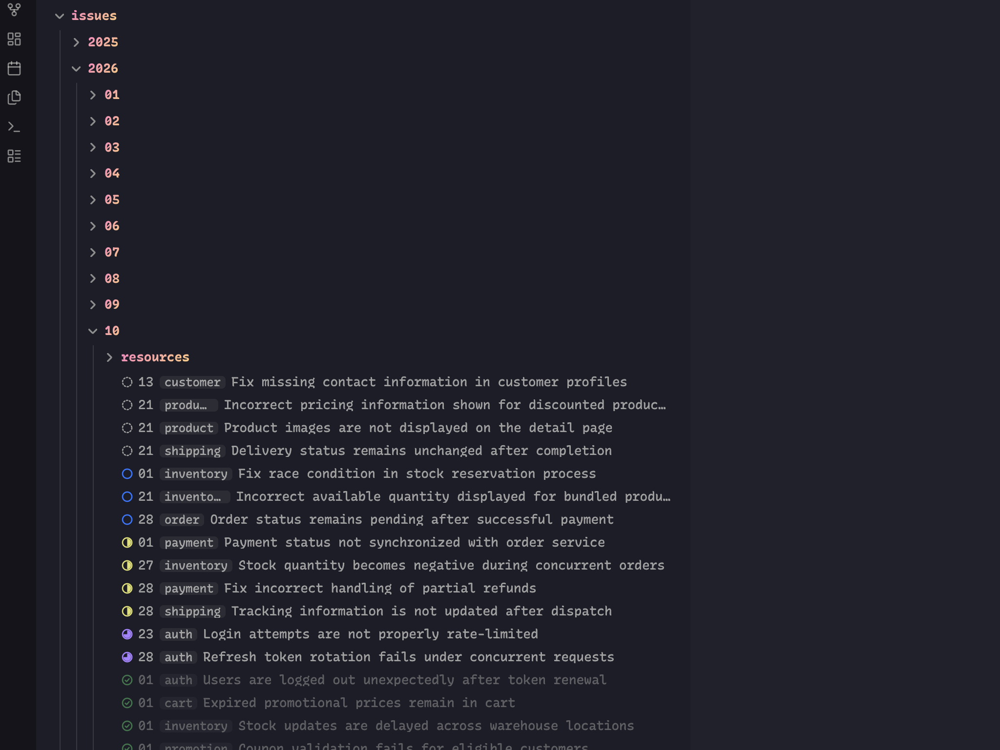

# Workholic

Show status, title, date, and category from frontmatter in the file explorer, and sort files by status, date, category, and title.



Add a `status` property to a note's frontmatter and Workholic marks it in the file explorer:

```yaml
---
status: IN_PROGRESS
---
```

## Statuses

`BACKLOG` → `READY` → `IN_PROGRESS` → `IN_REVIEW` → `DONE`

Values are matched loosely, so `in progress`, `In-Progress`, and `IN_PROGRESS` all resolve to the same status. Anything unrecognized is treated as having no status.

## Setting a status

You don't have to remember the values or type them. A status picker is available from two places:

- **Right-click a file** in the file explorer → **Set status**
- **Command palette** → **Workholic: Set status** (assign a hotkey if you use it often)

Select several files first and the picker applies the status to all of them at once. The picker also offers **Clear status**, which removes the property.

Typing the value by hand still works, of course.

## Features

**Status indicators.** Files with a status are marked in the file explorer. Four presets are available:

| Preset | Looks like |
| --- | --- |
| Status icon *(default)* | An icon whose shape tracks progress — dashed circle, empty circle, half, three-quarter, check |
| Left accent bar | A colored bar down the left edge of the row |
| Text badge | A small label at the right edge (`Backlog`, `Ready`, `WIP`, `Review`, `Done`) |
| Accent bar and icon | Both, for maximum visibility |

The icons are inline SVG masks rather than font glyphs, so they render identically on desktop and mobile instead of depending on font coverage. Shape carries the status on its own, which keeps the indicators readable without relying on color alone.

Colors come from Obsidian's theme variables, so they follow your theme in both light and dark mode.

**Dim completed files.** Files marked `DONE` fade back so unfinished work stands out. On by default.

**Sort by status.** Files are grouped by status in the file explorer. Your existing sort order (name, modified time, …) is preserved *within* each status group, and files without a status go last. Folders keep their positions.

**Labels from frontmatter.** Files are listed in the file explorer as `day category title`, built from the note's properties:

```yaml
---
title: Quarterly planning
date: 2026-11-11
category: Planning
---
```

shows as **`11`** `Planning` **Quarterly planning**.

- **Title** replaces the file name. Hover the row to see the real file name.
- **Day** is the day of the month from `date`, always two digits (`05`, `11`). Date and datetime values both work.
- **Category** is shown as a small badge. A list of categories is joined with commas, and links such as `[[Planning]]` show their name.

Each part appears only when the note has it, so a note with nothing but a title shows just the title, and a note with none of them shows its file name as before. Each part can be turned off in settings.

Renaming from the file explorer (F2, or **Rename…** in the context menu) still edits the real file name, never the title.

**Sort by date, category, and title.** When the file explorer is sorted by name (A to Z or Z to A), files are ordered by what you see instead of their file name: by date first (while days are shown), then by category (while categories are shown), then by title. Files without a date or category follow the ones that have it in both directions. With **Sort by status** on, status still comes first. Sorting by modified or created time is unaffected.

## Settings

| Setting | Default | Notes |
| --- | --- | --- |
| Status property | `status` | Frontmatter property to read. |
| Status indicators | on | Turns the markers on or off. |
| Indicator style | Status icon | See the presets above. |
| Dim completed files | on | Fades `DONE` files. |
| Sort by status | on | See the caveat below. |
| Show titles | on | Shows the title property in place of the file name. |
| Title property | `title` | Frontmatter property to read. |
| Show day | on | Shows the day of the month ahead of the name. |
| Date property | `date` | Frontmatter property to read. |
| Show category | on | Shows the category ahead of the name. |
| Category property | `category` | Frontmatter property to read. |
| Sort by date, category, and title | on | Applies only while the explorer is sorted by name. |

## Customizing colors

Override the palette in a CSS snippet:

```css
.theme-light,
.theme-dark {
  --workholic-color-backlog: var(--text-faint);
  --workholic-color-ready: var(--color-blue);
  --workholic-color-in-progress: var(--color-yellow);
  --workholic-color-in-review: var(--color-purple);
  --workholic-color-done: var(--color-green);
  
  --workholic-icon-size: 0.95em;
  --workholic-bar-width: 3px;
  --workholic-done-opacity: 0.5;

  --workholic-day-color: var(--text-faint);
  --workholic-category-color: var(--text-muted);
  --workholic-category-background: var(--background-modifier-hover);
}
```

To swap an icon, override `--workholic-icon` on the matching status:

```css
.nav-file-title[data-workholic-status='IN_PROGRESS'] {
  --workholic-icon: url("data:image/svg+xml,...");
}
```

## Caveats

**Sorting is per folder.** The file explorer sorts each folder independently, so statuses group within a folder rather than across the whole vault. For a vault-wide status board, use a Base with `group by status`.

**Sorting and labels rely on an internal API.** Obsidian does not expose the file explorer to plugins, so these features hook internal methods. They are feature-detected and fail safe: if a future Obsidian release changes those methods, sorting reverts to the default order, files show their file names again, and the status indicators keep working. Indicators themselves use only public API and CSS.

**Labels show only in the file explorer.** Tabs, search, the quick switcher, and links still use the file name.

**Hover has no equivalent on mobile.** Tapping opens the note as usual, so the real file name is not shown there.

**Indicators are DOM-driven.** The file explorer virtualizes its rows, so Workholic watches it with a MutationObserver and stamps each row with a `data-workholic-status` attribute. All styling is static CSS keyed off that attribute, so the cost does not grow with vault size.

## Development

```bash
npm install
npm run dev     # watch build
npm run build   # type-check and production build
npm run lint
```

## License

MIT
